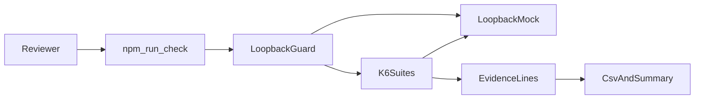

# Lumen Relay quality harness

Quality harness for Lumen Relay, a fictional local messenger. Contract, negative, and small load checks for identity, directory, device material, and profile, with architecture records and an evidence pack.

Lumen Relay is not a product you can sign up for. The API exists only in the loopback mock in [`mock/`](mock/README.md). The harness refuses any base URL that is not `http://127.0.0.1` or `http://localhost`. That keeps a portfolio run from ever calling a real service.

Copyright (c) 2026 NPS-Dive. The [LICENSE](LICENSE) is a proprietary evaluation notice, not an open-source license. You may view this repository and run it locally to evaluate the author for employment. Other uses need prior written consent. A public GitHub repository still follows GitHub's Terms of Service, including in-platform forks.

## Run

Install Node.js 20 or newer and k6 0.57 or newer (this tree was exercised with k6 2.1). From this directory:

```powershell
npm install
npm run check
```

`npm run check` starts a fresh mock for each script, runs the four suites, and writes `results/<run-id>/evidence.csv` plus `summary.md`. Those result files are gitignored. [`docs/examples/sample-summary.md`](docs/examples/sample-summary.md) shows the summary shape.

`npm run check:all` also type-checks the TypeScript and runs the Node tests. `node mock` serves the API alone on `http://127.0.0.1:8787`. `npm run mock` does the same.

## Trade-offs

- The mock is in memory and dies with the process. It is there so a reviewer can run the harness on a laptop, not so it can stand in for a deployed messenger.
- k6 runs the `.ts` files directly and strips types. It does not type-check them. `npm run check:types` does that with `tsc --noEmit`.
- Load is two virtual users for three seconds against loopback. That is enough to prove the runner, the thresholds, and the evidence line. It is not a capacity study.
- One repository holds the four areas so they share a single evidence contract. Four repositories would have duplicated the runner and drifted.
- The evaluation notice does not cancel GitHub's public-repository terms. A private repository would be the setting that actually withholds public viewing.

## Layout

```text
.
├── LICENSE
├── README.md
├── package.json
├── tsconfig.json
├── docs/
│   ├── github-about.md
│   ├── adr/
│   ├── architecture/
│   └── examples/
├── mock/
├── platform/
└── suites/
    ├── shared/
    ├── identity/
    ├── directory/
    ├── device-material/
    └── profile/
```

## Workflow



## Read next

- [Architecture](docs/architecture/README.md) for the C4 and sequence diagrams
- [Decision records](docs/adr/README.md) for why the harness is shaped this way
- [Platform](platform/README.md) for the runner and the evidence columns
- [Mock](mock/README.md) for the fictional API
- [Suites](suites/README.md) for the four areas
