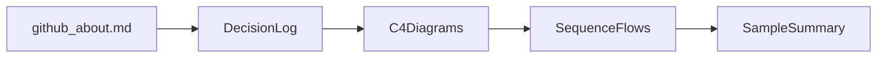

# Docs

The documents a reviewer can read without running anything: the GitHub description, the decision log, the C4 and sequence diagrams, and a sample evidence summary.

## Layout

```text
docs/
├── README.md
├── github-about.md
├── adr/
├── architecture/
└── examples/
```

## Workflow



Start with [github-about.md](github-about.md) for the one-sentence description, then [adr/README.md](adr/README.md) and [architecture/README.md](architecture/README.md). The sample in [examples/README.md](examples/README.md) is a format fixture, not the output of a live run.
