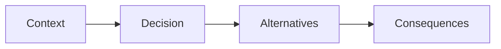

# Decision records

One decision per file. A record is not edited into a different decision later; a new record supersedes it. The dates are the day the decision was accepted for this repository.

## Layout

```text
docs/adr/
├── README.md
├── 0001-clean-room-fictional-product.md
├── 0002-loopback-only-execution.md
├── 0003-native-k6-typescript.md
├── 0004-one-evidence-contract.md
├── 0005-in-process-mock-as-sut.md
├── 0006-public-evaluation-notice.md
└── 0007-one-repository.md
```

## Workflow



| Record | Decision |
| --- | --- |
| [0001](0001-clean-room-fictional-product.md) | Original fictional product, no imported trees |
| [0002](0002-loopback-only-execution.md) | Refuse every non-loopback base URL |
| [0003](0003-native-k6-typescript.md) | k6 runs TypeScript directly |
| [0004](0004-one-evidence-contract.md) | Seven columns for every suite |
| [0005](0005-in-process-mock-as-sut.md) | The mock is the system under test |
| [0006](0006-public-evaluation-notice.md) | Public repository, evaluation-only grant |
| [0007](0007-one-repository.md) | One repository, four suites |
