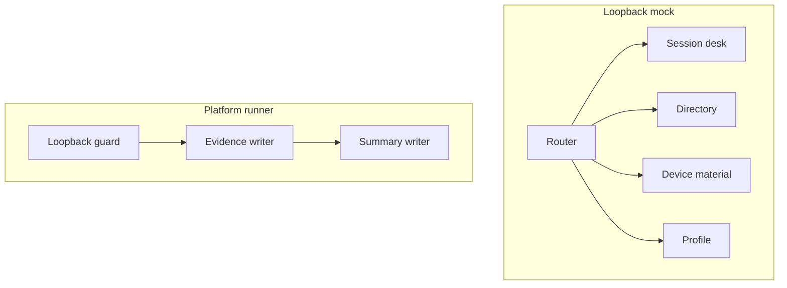

# C4 components

The mock is a route table over four in-memory areas. The runner is a guard, a line parser, and a summary writer. k6 scripts are the clients of the mock; they are a separate container and are not drawn again here.

## Layout

```text
docs/architecture/
├── README.md
├── c4-context.md
├── c4-container.md
├── c4-component.md
└── flows.md
```

## How this folder is read

```mermaid
graph LR
  context[C4Context] --> container[C4Container]
  container --> component[C4Component]
  component --> flows[SuiteSequences]
```



Suite sequences are in [flows.md](flows.md).
