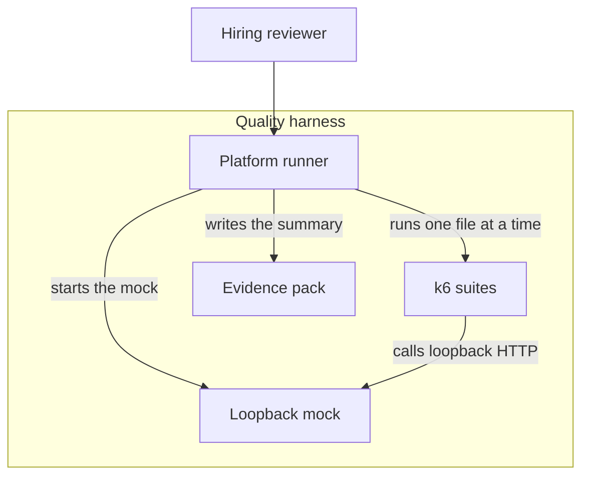

# C4 containers

The harness is four containers inside one repository. The evidence files are a data store with the lifetime of one run. They are not source.

## Layout

```text
docs/architecture/
├── README.md
├── c4-context.md
├── c4-container.md
├── c4-component.md
└── flows.md
```

## How this folder is read

```mermaid
graph LR
  context[C4Context] --> container[C4Container]
  container --> component[C4Component]
  component --> flows[SuiteSequences]
```



Components inside the mock and the runner are in [c4-component.md](c4-component.md).
