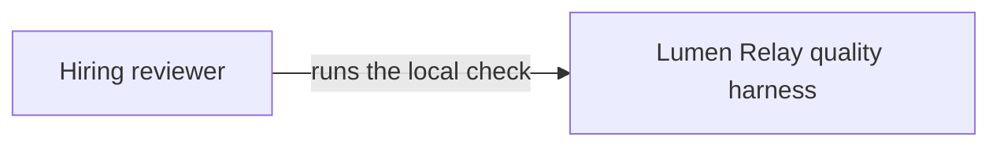

# C4 context

One person runs one local system. Lumen Relay has no signup, no hosted environment, and no upstream API.

## Layout

```text
docs/architecture/
├── README.md
├── c4-context.md
├── c4-container.md
├── c4-component.md
└── flows.md
```

## How this folder is read

```mermaid
graph LR
  context[C4Context] --> container[C4Container]
  container --> component[C4Component]
  component --> flows[SuiteSequences]
```



The next level is [c4-container.md](c4-container.md).
