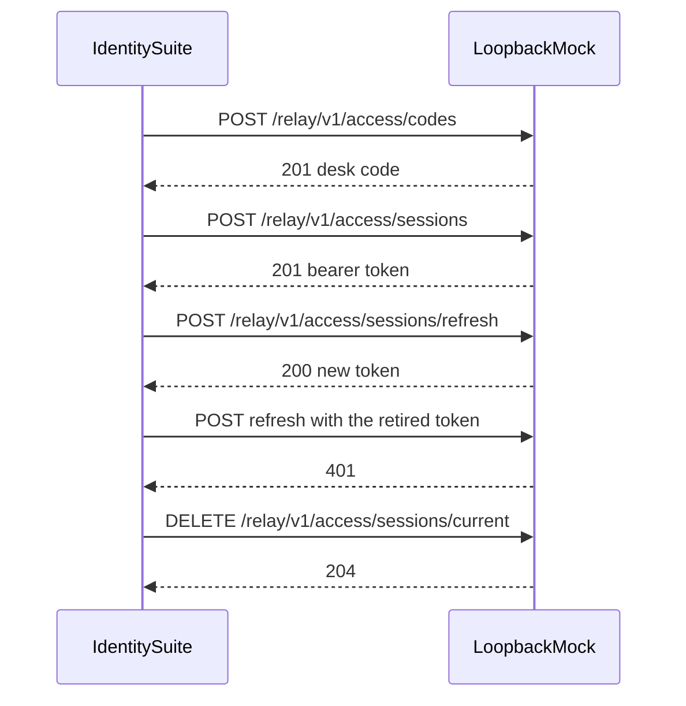
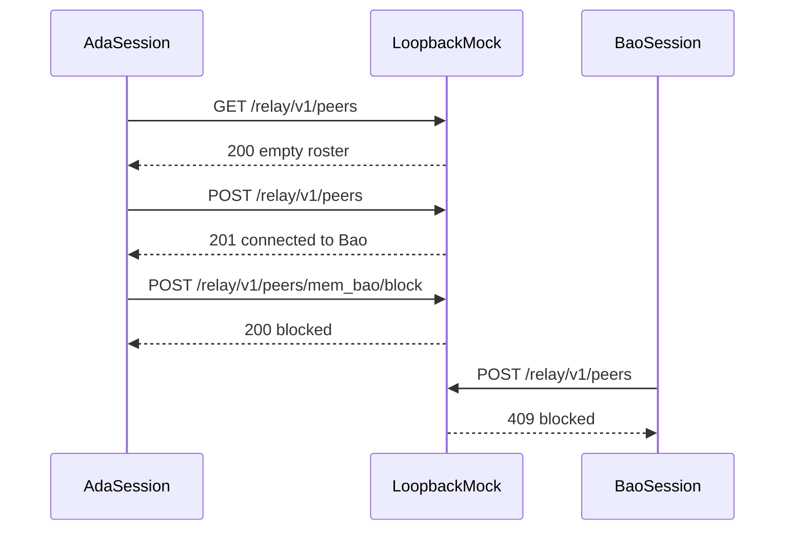
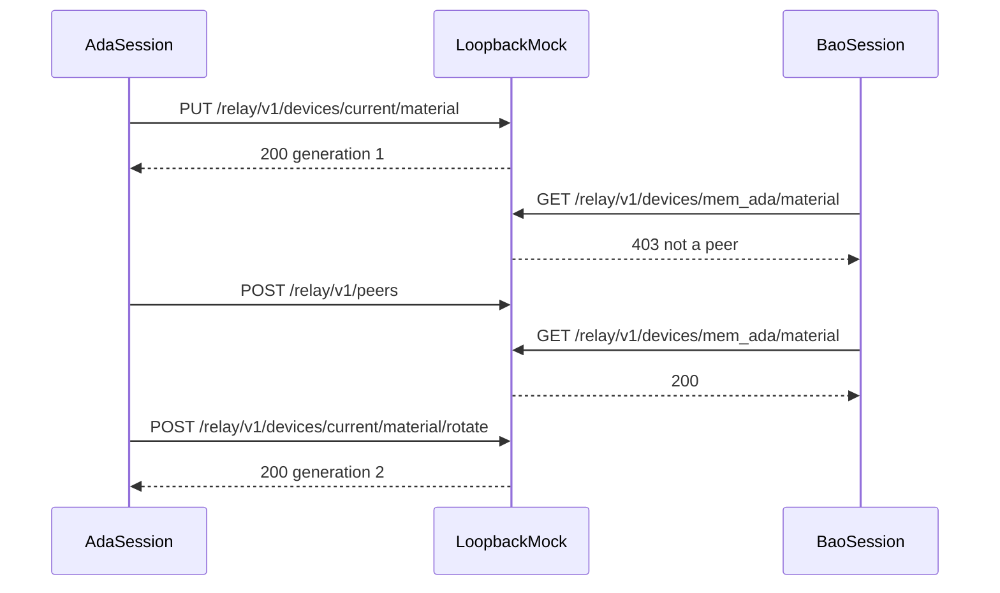
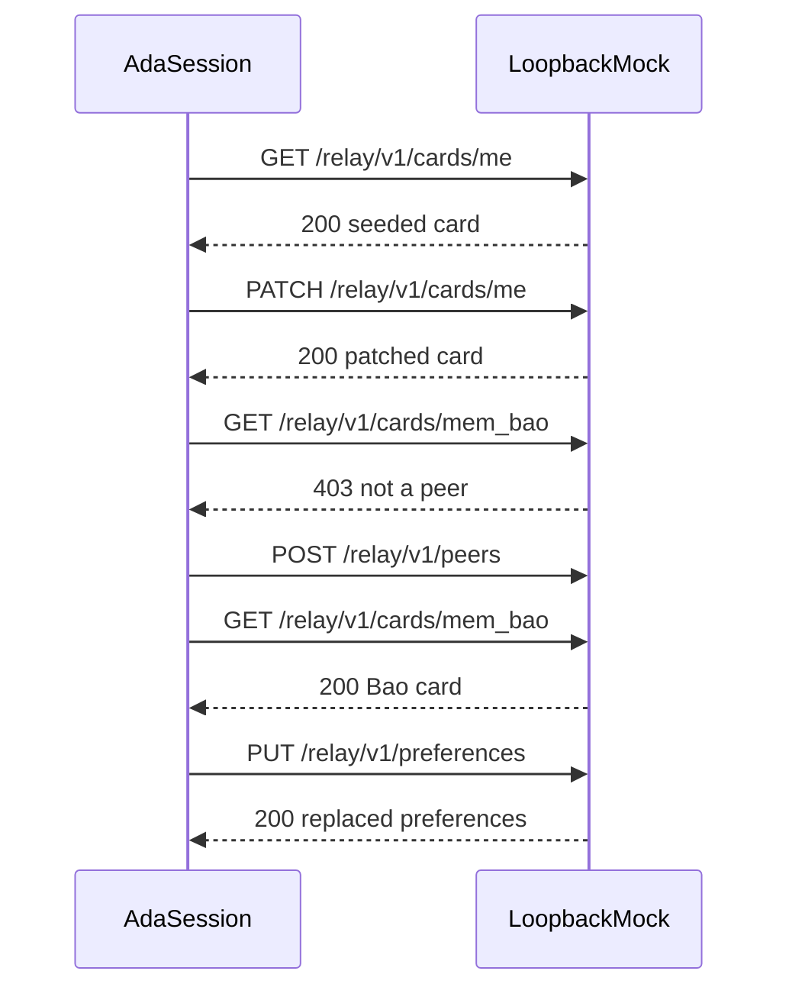

# Suite flows

Each suite is one iteration against a fresh mock, except the load scripts, which run for three seconds after the contract script. The platform restarts the mock between files.

## Layout

```text
docs/architecture/
├── README.md
├── c4-context.md
├── c4-container.md
├── c4-component.md
└── flows.md
```

## How this folder is read

```mermaid
graph LR
  context[C4Context] --> container[C4Container]
  container --> component[C4Component]
  component --> flows[SuiteSequences]
```

## Identity



## Directory



## Device material



## Profile


