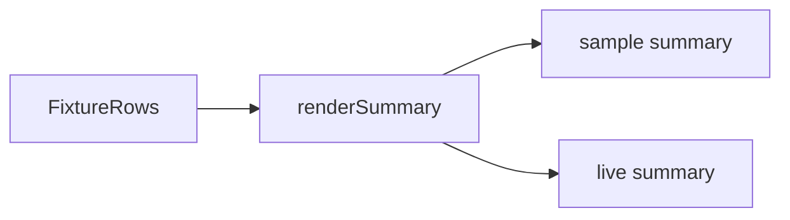

# Example summary

`sample-summary.md` is the output of the summary renderer for a fixed fixture. It is checked in so a reviewer can see the evidence shape without running k6. It is not a captured run. Live output goes to `results/`, which git ignores.

## Layout

```text
docs/examples/
├── README.md
└── sample-summary.md
```

## Workflow



`platform/report.test.mjs` fails if the renderer and the sample drift apart.
