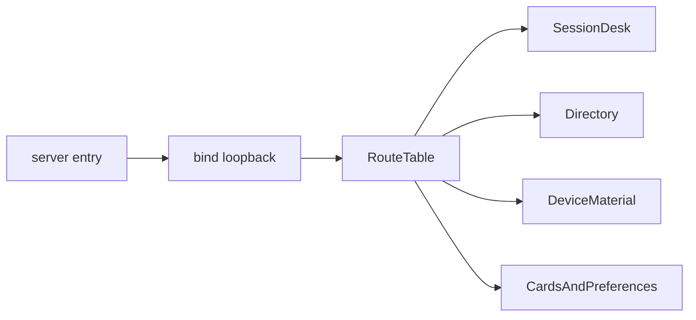

# Mock

In-memory HTTP API for the fictional Lumen Relay messenger. Two members are seeded: Ada Quinn (`ada`, `mem_ada`) and Bao Singh (`bao`, `mem_bao`). Nothing is written to disk, and the process does not call another host.

A connection is mutual. A block removes that connection in both directions and prevents either member from connecting again for the life of the process. That is a deliberate simplification so the directory, card, and device-material rules can be tested without an invitation inbox.

## Layout

```text
mock/
├── README.md
├── package.json
└── src/
    ├── app.mjs
    ├── app.test.mjs
    ├── server.mjs
    └── server.test.mjs
```

## Workflow



## Run

```powershell
npm run mock
```

The entrypoint always binds `127.0.0.1`. `HOST` is ignored. `PORT` defaults to `8787`. `GET /relay/v1/ready` returns `200` when the process is accepting requests.

## Routes

| Method and path | Auth | Success |
| --- | --- | --- |
| `GET /relay/v1/ready` | No | `200` process is up |
| `POST /relay/v1/access/codes` | No | `201` short-lived desk code for a known handle |
| `POST /relay/v1/access/sessions` | No | `201` bearer token; the desk code is single use |
| `POST /relay/v1/access/sessions/refresh` | Bearer | `200` new token; the presented token is retired |
| `DELETE /relay/v1/access/sessions/current` | Bearer | `204` session closed |
| `GET /relay/v1/peers` | Bearer | `200` connected peers |
| `POST /relay/v1/peers` | Bearer | `201` mutual connection |
| `POST /relay/v1/peers/{memberId}/block` | Bearer | `200` connection removed |
| `PUT /relay/v1/devices/current/material` | Bearer | `200` first publication, generation 1 |
| `POST /relay/v1/devices/current/material/rotate` | Bearer | `200` replacement, generation plus one |
| `GET /relay/v1/devices/{memberId}/material` | Bearer | `200` self, or a connected peer |
| `GET /relay/v1/cards/me` | Bearer | `200` own card |
| `PATCH /relay/v1/cards/me` | Bearer | `200` display name and status line |
| `GET /relay/v1/cards/{memberId}` | Bearer | `200` self, or a connected peer |
| `GET /relay/v1/preferences` | Bearer | `200` notification preferences |
| `PUT /relay/v1/preferences` | Bearer | `200` mentions and quiet hours replaced |

Bodies that carry JSON must use `Content-Type: application/json` and stay under 16 KiB. `publicMaterial` is an opaque URL-safe string of 16 to 512 characters. The mock stores it and returns it. It does not generate keys.

Publishing a second, different value returns `409`. The client rotates instead. Repeating the current value on publish returns the current generation.

## Tests

`npm run check:node` covers the route rules and asserts that the entrypoint binds `127.0.0.1` even if `HOST=0.0.0.0`.
