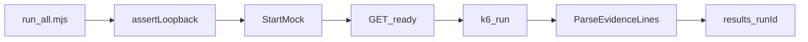

# Platform

The runner that a reviewer actually invokes. It refuses a non-loopback base URL before k6 starts, starts a fresh mock for every script, collects evidence lines, and writes an English summary.

## Layout

```text
platform/
├── README.md
├── guard.mjs
├── guard.test.mjs
├── evidence.mjs
├── evidence.test.mjs
├── report.mjs
├── report.test.mjs
├── run-all.mjs
└── run-all.test.mjs
```

## Workflow



A failed script does not stop the rest of the pack. The process exits non-zero if k6 exits non-zero, if a script records no evidence, if any row failed, or if one of the four suites is missing.

## Evidence

Each k6 case prints one line:

```text
LUMEN_EVIDENCE {"runId":"...","suite":"identity","caseId":"ID-OPEN-SESSION","outcome":"pass","status":201,"latencyMs":4,"detail":"Session opened."}
```

The CSV columns are `runId`, `suite`, `caseId`, `outcome`, `status`, `latencyMs`, `detail`. Tokens and desk codes are not written into `detail`.

`results/<run-id>/` is gitignored. The checked-in shape is [`docs/examples/sample-summary.md`](../docs/examples/sample-summary.md).

## Guard

Allowed origins are `http://127.0.0.1:<port>` and `http://localhost:<port>` with no user, password, path, query, or fragment. The default is `http://127.0.0.1:8787`. Pass `--base-url` or set `BASE_URL` only to change the loopback port.

```powershell
node platform/run-all.mjs --base-url http://203.0.113.10:8787
```

That command exits before k6 is started.
