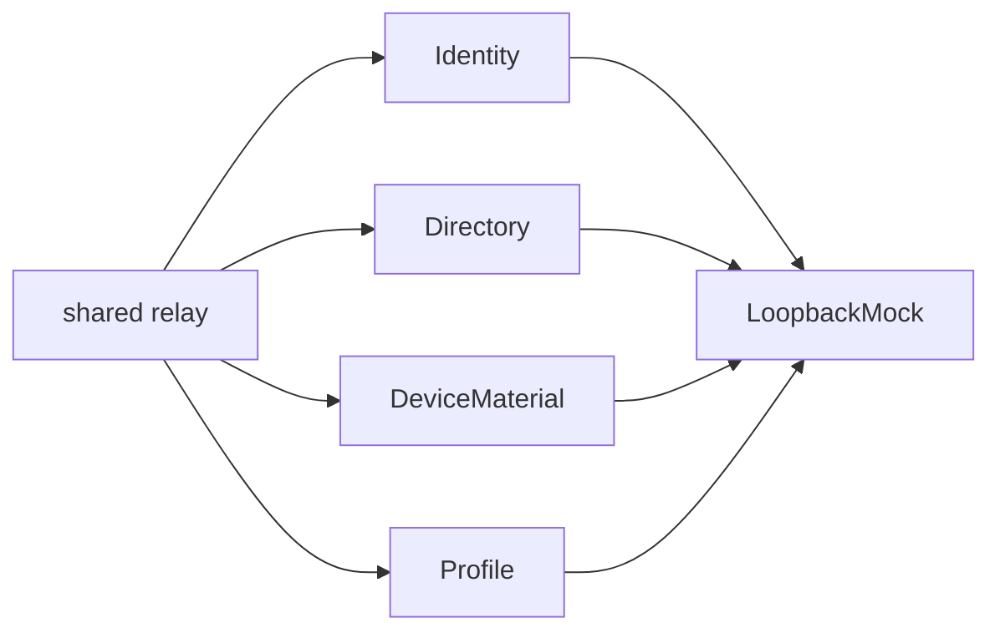

# Suites

Four k6 areas over the same loopback API. Each area has a single-iteration contract script and a three-second load script. Shared request, evidence, and loopback helpers live in `shared/`. The k6 scripts also refuse a non-loopback `BASE_URL`, so a direct `k6 run` cannot point at another host either.

## Layout

```text
suites/
├── README.md
├── shared/
├── identity/
├── directory/
├── device-material/
└── profile/
```

## Workflow



The platform runner restarts the mock before every file, so a contract script cannot leak roster or material state into the following load script.

| Area | What it proves |
| --- | --- |
| [Identity](identity/README.md) | Desk codes, single-use exchange, refresh retirement, close |
| [Directory](directory/README.md) | Empty roster, mutual connect, block |
| [Device material](device-material/README.md) | Publish, hide from non-peers, rotate |
| [Profile](profile/README.md) | Own card, peer card, preferences |
