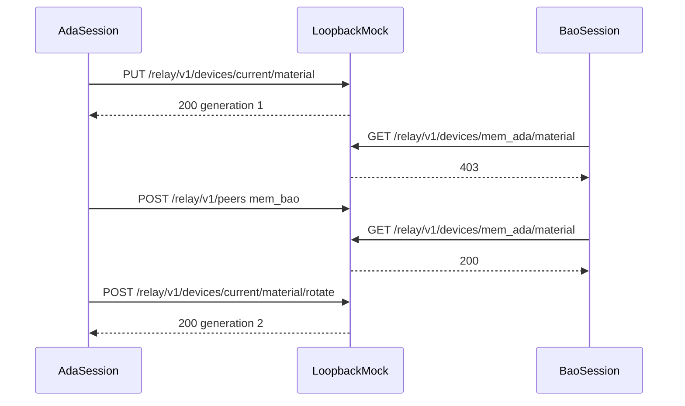

# Device material suite

Proves publication and rotation of an opaque public blob. The mock does not create keys. A value must be 16 to 512 URL-safe characters. The first publish is generation 1. A different value is a conflict until the client rotates it. Bao cannot read Ada's material until they are connected.

The load script publishes once in `setup` and then reads that material for three seconds.

## Layout

```text
suites/device-material/
├── README.md
├── material.flow.ts
└── material.load.ts
```

## Workflow



## Cases

- `MAT-PUBLISH-UNAUTHENTICATED`, `MAT-ROTATE-EMPTY`, `MAT-PUBLISH-MALFORMED`, `MAT-READ-UNKNOWN`
- `MAT-PUBLISH`, `MAT-PUBLISH-GENERATION`, `MAT-PUBLISH-CONFLICT`, `MAT-READ-SELF`
- `MAT-READ-HIDDEN`, `MAT-CONNECT`, `MAT-READ-PEER`
- `MAT-ROTATE-SAME`, `MAT-ROTATE`, `MAT-ROTATE-GENERATION`
- `MAT-LOAD`
