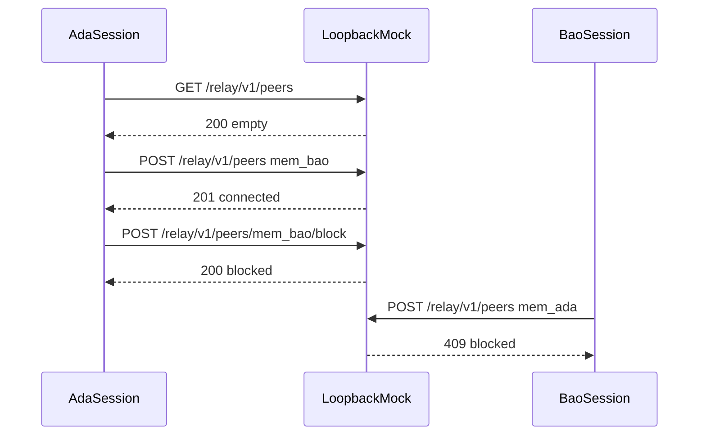

# Directory suite

Proves the roster. Ada starts with no peers, cannot connect to herself, can connect to Bao, sees that connection, and then blocks Bao. Bao cannot reconnect during the same process. The load script reads the roster for three seconds.

## Layout

```text
suites/directory/
├── README.md
├── roster.flow.ts
└── roster.load.ts
```

## Workflow



## Cases

- `DIR-LIST-UNAUTHENTICATED`, `DIR-ADD-SELF`, `DIR-ADD-UNKNOWN`
- `DIR-LIST-EMPTY`, `DIR-LIST-EMPTY-SHAPE`, `DIR-ADD`
- `DIR-LIST-CONNECTED`, `DIR-LIST-CONNECTED-MEMBER`, `DIR-ADD-AGAIN`
- `DIR-BLOCK`, `DIR-LIST-AFTER-BLOCK`, `DIR-LIST-AFTER-BLOCK-SHAPE`, `DIR-ADD-BLOCKED`
- `DIR-LOAD`
