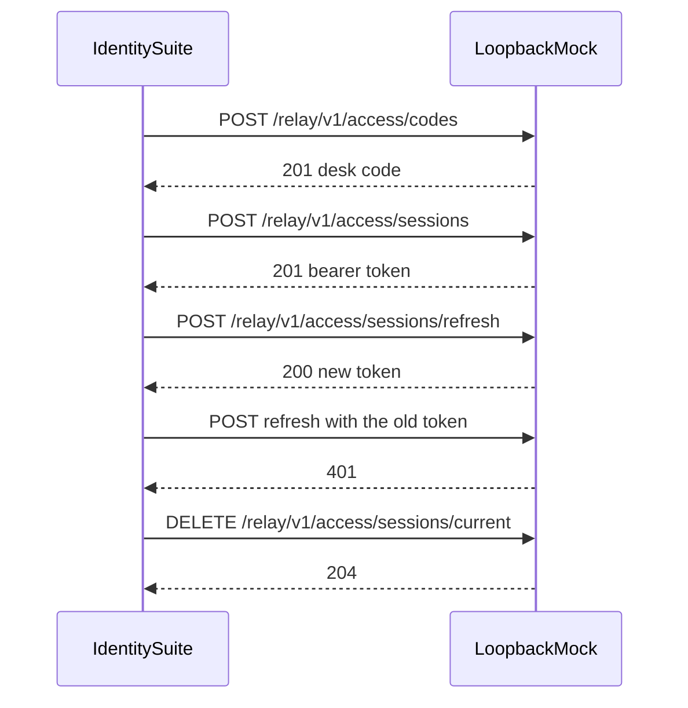

# Identity suite

Proves the session desk: malformed and unknown handles, an unknown desk code, a missing token, a single-use code, refresh that retires the previous token, and close.

The load script opens sessions as Ada for three seconds with two virtual users. It records one evidence row, `ID-LOAD`, from the end-of-test summary.

## Layout

```text
suites/identity/
├── README.md
├── session.flow.ts
└── session.load.ts
```

## Workflow



## Cases

- `ID-CODE-MALFORMED`, `ID-CODE-UNKNOWN`, `ID-SESSION-REJECTED`, `ID-CLOSE-UNAUTHENTICATED`
- `ID-OPEN-CODE`, `ID-OPEN-SESSION`, `ID-OPEN-MEMBER`
- `ID-REFRESH`, `ID-REFRESH-STALE`, `ID-CLOSE`
- `ID-LOAD`

Negative cases run before a session exists, so a broken happy path cannot hide them.
