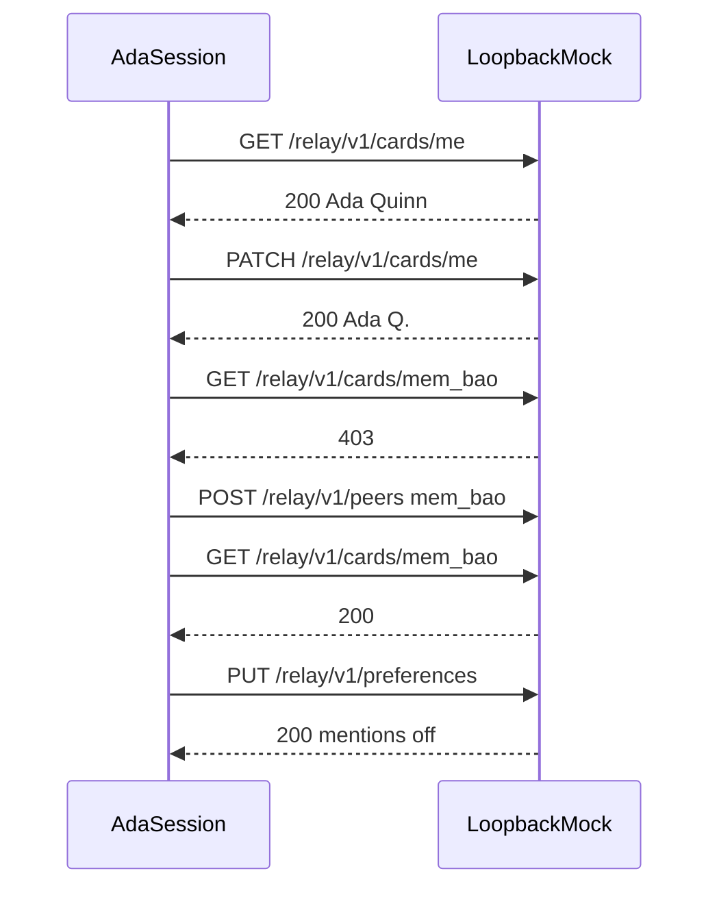

# Profile suite

Proves Ada's card, a patch of the display name and status line, the peer gate on Bao's card, and a full replacement of notification preferences. `mentions` is `immediate`, `daily`, or `off`. `quietHours` is a boolean, not a string.

The load script reads Ada's own card for three seconds.

## Layout

```text
suites/profile/
├── README.md
├── card.flow.ts
└── card.load.ts
```

## Workflow



## Cases

- `PRF-READ-UNAUTHENTICATED`, `PRF-PATCH-MALFORMED`, `PRF-PREF-MALFORMED`
- `PRF-READ-SELF`, `PRF-READ-SELF-NAME`, `PRF-PATCH`, `PRF-PATCH-NAME`
- `PRF-READ-PEER-FORBIDDEN`, `PRF-CONNECT`, `PRF-READ-PEER`, `PRF-BLOCK`, `PRF-READ-BLOCKED`
- `PRF-PREF-READ`, `PRF-PREF-READ-SHAPE`, `PRF-PREF-REPLACE`, `PRF-PREF-REPLACE-SHAPE`
- `PRF-LOAD`
