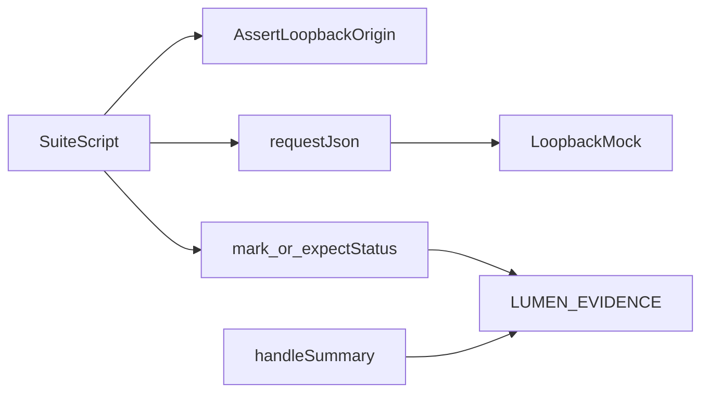

# Shared k6 helpers

Helpers imported by the four suites. They are TypeScript executed by k6, not a Node library.

## Layout

```text
suites/shared/
├── README.md
└── relay.ts
```

## Workflow



`origin()` reads `BASE_URL` and aborts the virtual user unless it is loopback HTTP with no path. `mark()` records one evidence row and one k6 check. `console.log` is how a contract case emits that row. k6 wraps console output in its log format, and the runner unwraps it. `openSession()` asks for a desk code and exchanges it. It does not print the code or the token. Load scripts return one evidence line from `handleSummary` as raw `stdout`, because k6 does not reliably show `console.log` during the summary phase. Each load iteration sleeps for a tenth of a second so the three-second run stays a small loopback check.
